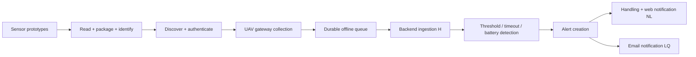

# Hướng dẫn hoàn thành phần việc LQ

> Nếu cần nộp từng task riêng, mở [bộ 23 hồ sơ task LQ](tasks/LQ/README.md). Mỗi file đã có acceptance checklist, bằng chứng, cách kiểm tra, handoff và comment Jira để copy.

## 1. Cách đọc tài liệu

Tài liệu này tổng hợp các task có avatar **LQ** trong ảnh phân công ngày 17/11/2026. Tổng cộng có **23 task**:

- Trên board: SCRUM-19 và SCRUM-29 đang ở `Done`; 21 task còn lại đang ở `To Do`.
- Trạng thái board không tự động chứng minh code/tài liệu đã đạt acceptance criteria.
- Cột “đánh giá repository” dưới đây phản ánh bản đã cập nhật ngày 17/11/2026. Code và kiểm thử kỹ thuật đã có; vẫn cần review nhóm và đính kèm commit/log vào Jira trước khi chuyển task sang `Done`.

Lưu ý quan trọng: `F9`, `F20`, `F23` trong tên ba task đầu là mã feature/backlog. Chúng không phải functional requirement `F09`/`F20`; các task liên quan functional requirement có ghi rõ `(F09)`, `(F20)` trong tên.

### Quy ước trạng thái

| Nhãn | Ý nghĩa |
|---|---|
| Đã triển khai – test pass | Implementation đã chạy qua test tự động hoặc E2E nêu ở mục 4 |
| Tài liệu hoàn chỉnh – cần review nhóm | Artifact đã có trong repo; cần H/NL/giảng viên xác nhận contract/phạm vi |
| Chờ xác nhận phần cứng/backend thật | Simulator hoặc mock đã pass; nghiệm thu production phụ thuộc testbed/module thành viên khác |

## 2. Vai trò tổng thể của phần LQ

Phần LQ tạo “xương sống edge-to-cloud”:



Nhờ phần này:

- nhóm H nhận được payload và batch contract ổn định để làm ingestion/validation/deduplication;
- nhóm NL nhận được alert record để xử lý, đóng và hiển thị web notification;
- dashboard có latest/history/status thay vì chỉ dữ liệu mẫu;
- nhóm kiểm thử có kịch bản mất mạng, node lạ, chữ ký sai, timeout, pin yếu và vượt ngưỡng;
- nhóm triển khai có sơ đồ, cấu hình và manual để demo/bàn giao.

## 3. Danh sách task và cách hoàn thành

### A. Thiết kế và môi trường

| Task | Đánh giá repository | Quy trình dễ hiểu để hoàn thành | Đóng góp/phụ thuộc |
|---|---|---|---|
| **SCRUM-22 – F9 Prepare Sensor/Gateway Development Environment** | **Đã triển khai – test pass:** `scripts/check-environment.ps1`, build/run PowerShell + batch tự tìm JDK 17+, `.env.example`; checker nhận đúng JDK 27/Node 24/npm 11 trên máy hiện tại. | 1) Chạy checker. 2) Build farm-sim. 3) `npm ci` + build dashboard. 4) Chạy demo và lưu log/screenshot. | Cho mọi thành viên một môi trường tái lập; là đầu vào cho toàn bộ task sensor/gateway. |
| **SCRUM-19 – F20 Create Deployment Diagram** | Board `Done`; **tài liệu hoàn chỉnh – cần review nhóm:** `docs/deployment/deployment-diagram.md`, có node/artifact/protocol/port và phân biệt demo với kiến trúc mục tiêu. | Mở Mermaid, kiểm tra đủ Sensor/UAV/Gateway/Local Store/Backend/DB/Web; review với nhóm backend/deploy. | Giúp nhóm hiểu thành phần chạy ở đâu, kết nối thế nào; trace F18–F20 và NFR03–05. |
| **SCRUM-29 – F23 Design Sensor–Gateway Communication Protocol** | Board `Done`; **tài liệu hoàn chỉnh – cần review nhóm:** `docs/protocol/sensor-gateway-protocol.md`, bao phủ schema, HMAC, replay, lỗi, retry và versioning. | Review beacon/request/packet/batch; chốt response/dedupe contract với H. | Ngăn sensor, gateway và backend dùng schema khác nhau. |

### B. Sensor node và UAV gateway

| Task | Đánh giá repository | Quy trình dễ hiểu để hoàn thành | Đóng góp/phụ thuộc |
|---|---|---|---|
| **SCRUM-64 – F38 Build Light, pH and Water Level Sensor Prototype** | **Có bằng chứng – cần review:** `LightSensor`, `PhSensor`, `WaterLevelSensor`, `SensorType`. Hiện là simulator, phù hợp điều kiện acceptance khi chưa có hardware testbed. | Chạy nhiều lần đo; kiểm tra light `0..120000 lux`, pH `0..14`, water `0..100%`, unit/status đúng; lưu output test. | Hoàn thiện ba chỉ số còn thiếu trong bộ dữ liệu nông trại. |
| **SCRUM-65 – F39 Implement Sensor Data Reading** | **Có bằng chứng – cần review:** `Sensor`, `SimulatedSensor`, `Reading`; lấy 5 mẫu, tính trung bình, có `OK/ERROR`. | Kiểm tra sample/average, giới hạn range, raw ADC nếu có, lỗi đọc trả `value:null`; thêm test deterministic bằng seed. | Chuẩn hóa đầu vào trước đóng gói và validation. |
| **SCRUM-66 – F40 Implement Sensor Data Packaging** | **Có bằng chứng – cần review:** `PacketBuilder`, `Reading.toJson()`. | Sinh packet, parse lại JSON, đối chiếu đủ `v,nodeId,seq,nonce,ts,battery,readings,sig`; gửi mẫu cho H. | Hợp đồng dữ liệu giữa node, gateway, backend và dashboard. |
| **SCRUM-67 – F41 Implement Sensor Node Identification** | **Có bằng chứng – cần review:** `NodeIdentity`, format `NODE-001`. | Test ID đúng/sai/null; xác nhận ID duy nhất trong registry và kèm model/firmware/farm. | Cho phép quản lý thiết bị, dedupe và gắn dữ liệu đúng node. |
| **SCRUM-68 – F42 Implement Sensor Discovery Mechanism** | **Có bằng chứng – cần review:** `beaconJson()`, `RadioMedium.discover()`. | Đặt node trong/ngoài range; kiểm tra chỉ node trong tầm xuất hiện, beacon có capability; thử nhiều RSSI. | Hiện thực phần discovery của F18. |
| **SCRUM-69 – F43 Implement Sensor Authentication** | **Có bằng chứng – cần review:** HMAC-SHA256 trong `Auth`, key registry và verify trong `DataCollector`. | Chạy node đúng key; sau đó unknown node, bad key, wrong nonce, seq cũ và clock skew; xác nhận tất cả case xấu bị reject/log. | Chỉ thu dữ liệu từ thiết bị đăng ký; đáp ứng F18/NFR03. |
| **SCRUM-70 – F44 Build UAV Mobile Gateway Prototype** | **Có bằng chứng – cần review:** `UavGateway` mô phỏng speed/altitude/range/waypoint/lat-lon. | Chạy mission, xác nhận đi đủ waypoint/về base và vị trí thay đổi; ghi rõ đây không phải flight control thật. | Tạo nền mobile gateway mà không vượt phạm vi dự án. |
| **SCRUM-71 – F45 Implement Gateway Data Collection** | **Có bằng chứng – cần review:** `DataCollector`. | Quan sát luồng discover → request → verify → wrap metadata → append; xác nhận packet loss được thử lại và một node chỉ thu một lần mỗi mission. | Nối sensor node với hàng đợi/backend, kèm thời gian/vị trí/RSSI. |
| **SCRUM-74 – F48 Implement Local Data Storage (F20)** | **Đã triển khai – test pass:** `LocalStore` JSONL ghi temp + fsync + atomic move, reload qua restart, capacity/drop counter; `Main` không còn tự xóa queue. | Append record, đóng/mở lại store và kiểm tra dữ liệu còn; test FIFO/capacity; chỉ xóa khi chủ động dùng `--reset-queue`. | Bảo vệ dữ liệu khi Internet gián đoạn; đầu vào cho F50–F52. |

### C. Offline queue, connectivity và retry

| Task | Đánh giá repository | Quy trình dễ hiểu để hoàn thành | Đóng góp/phụ thuộc |
|---|---|---|---|
| **SCRUM-76 – F50 Implement Offline Data Queue** | **Đã triển khai – test pass:** FIFO durable, batch/ack, pending chỉ bị xóa sau response hợp lệ; record backend reject vào dead-letter cùng raw data/lý do. | Tắt API: queue tăng và sống qua restart. Bật API: accepted/duplicate được ack; rejected vào `gateway-dead-letter.jsonl`. | Cốt lõi store-and-forward của F20/NFR05. |
| **SCRUM-77 – F51 Implement Internet Connectivity Detection** | **Đã triển khai – test pass:** `ConnectivityMonitor` giữ `UNKNOWN/ONLINE/DEGRADED/OFFLINE`, thời điểm, HTTP status, số lỗi liên tiếp và nguyên nhân. | Mô phỏng online→offline→online; xem summary/log hoặc `uploader.connectivity()`; lỗi không xóa queue. | Cung cấp tín hiệu để tự động sync/retry và hiển thị tình trạng gateway. |
| **SCRUM-78 – F52 Implement Automatic Retry Mechanism** | **Đã triển khai – test pass:** `RetryPolicy` exponential backoff có max+jitter; `Uploader.syncIfDue()` chạy trong vòng lặp gateway. E2E offline-first đồng bộ đủ 12 record, queue về 0. | Tắt API, tạo pending; bật API lại; xác nhận `OFFLINE→ONLINE`, queue 0 và server dedupe. | Hoàn tất F20/NFR04/NFR05; backend thật của H phải giữ dedupe `(nodeId,seq)`. |

### D. Threshold, detection, alert và email

| Task | Đánh giá repository | Quy trình dễ hiểu để hoàn thành | Đóng góp/phụ thuộc |
|---|---|---|---|
| **SCRUM-112 – F86 Implement Sensor Threshold Configuration (F09)** | **Đã triển khai – test pass:** `AlertPolicy` có global/per-node override, persistence+audit; `GET/PATCH /api/v1/config/alert-rules`, mutation cần `X-Admin-Key`. | Set `FARM_ADMIN_KEY`; PATCH metric/min/max/nodeId hoặc stale/pin; restart và GET để xác nhận persistence. | Cho Farm Administrator kiểm soát điều kiện cảnh báo. Backend thật cần nối auth/RBAC của H. |
| **SCRUM-113 – F87 Implement Data Timeout Detection (F09)** | **Đã triển khai – test pass:** `AlertEngine` dùng timeout cấu hình, tạo một active `DATA_TIMEOUT`, tự resolve khi dữ liệu mới đến. | Test trước/sau mốc và gửi packet mới; kiểm tra history không nhân đôi. | Phát hiện node ngừng gửi dữ liệu; đáp ứng NFR02. |
| **SCRUM-114 – F88 Implement Low Battery Detection (F09)** | **Đã triển khai – test pass:** ngưỡng pin cấu hình, severity WARNING/CRITICAL, dedupe và auto-resolve. | Gửi battery trên/dưới ngưỡng; kiểm tra value/threshold/status/history. | Cho đội vận hành thay pin trước khi node chết. |
| **SCRUM-115 – F89 Implement Abnormal Sensor Data Detection** | **Đã triển khai – test pass:** so rule global/per-node sau validation, xử lý low/high, ánh sáng ban đêm và `SENSOR_READ_ERROR`. | Test boundary + reading error; GET alert và dashboard status. | Biến dữ liệu môi trường bất thường thành sự kiện có thể xử lý. Phụ thuộc F47 của H và F86. |
| **SCRUM-116 – F90 Implement Alert Creation and Management (F08)** | **Đã triển khai – test pass:** append-only `AlertRepository`, active dedupe, persistence/reload, list/detail/status/history API. | GET `/api/v1/alerts`; PATCH `/{id}/status` với key+actor+note; restart kiểm tra audit còn nguyên. | Nguồn alert cho F91 handling/closing và F92 web notification của NL. |
| **SCRUM-119 – F93 Implement Email Notifications (F10)** | **Đã triển khai – test pass ở chế độ outbox:** template alert, outbox durable, SMTPS cấu hình qua env, retry backoff; lỗi email không rollback alert. Cần SMTP account thật để nghiệm thu gửi ngoài. | Cấu hình `ALERT_EMAIL_TO`, `ALERT_EMAIL_FROM`, `SMTP_*`; tạo alert; kiểm tra gửi hoặc pending outbox/retry log. | Kênh cảnh báo ngoài web để quản trị viên phản ứng kịp thời. Phụ thuộc F90. |

### E. Cấu hình, cài đặt và bàn giao

| Task | Đánh giá repository | Quy trình dễ hiểu để hoàn thành | Đóng góp/phụ thuộc |
|---|---|---|---|
| **SCRUM-142 – F116 Configure Gateway and Sensor Nodes** | **Đã triển khai – test pass:** `config/farm-sim.properties` + `FarmConfig` validate gateway/nodes/range/route/API/timeout/capacity/retry; HMAC key random 32 byte sinh vào file runtime bị gitignore. | Sửa properties, chạy build/test; dùng `FARM_SIM_CONFIG` hoặc `--config`; không commit `data/node-keys.properties`. | Cho phép thêm gateway/node/farm mà không sửa core code; đáp ứng NFR03/NFR07. |
| **SCRUM-143 – F117 Prepare Installation Manual** | **Tài liệu hoàn chỉnh – cần một thành viên khác chạy walkthrough:** `docs/installation-manual.md`. | Người không viết module làm đúng manual trên checkout sạch, ghi PASS/FAIL rồi đính kèm Jira. | Giúp nhóm demo, QA và bàn giao hệ thống có thể lặp lại. |

## 4. Bằng chứng kiểm thử ngày 17/11/2026

| Kiểm thử | Kết quả |
|---|---|
| Environment checker | PASS – tìm đúng JDK 27 trong `.jdks`, Node 24 và npm 11 dù `PATH` đang trỏ Java 8 |
| Java compile | PASS – Java 17 target, `-Xlint:all`, không warning |
| `farm.tests.TestRunner` | **7 PASS, 0 FAIL**: policy, alert persistence/dedupe/lifecycle, detector, email outbox, LocalStore, HMAC, FarmConfig/KeyStore |
| Dashboard production build | PASS – TypeScript + Vite build exit 0; chỉ còn warning khuyến nghị code-split bundle 610 kB |
| Dashboard lint | PASS – ESLint exit 0 |
| E2E `--offline-first` | PASS – mission 1 giữ queue; mission 2 server lên, **12 record sync, queue 0, state ONLINE** |
| Security scenario | PASS – `NODE-098` unknown và `NODE-099` HMAC sai đều bị reject; không vào queue |
| Alert integration | PASS – ingestion tạo alert persisted, dashboard nhận 72 measurement rows trong bài offline-first |
| Alert REST API | PASS – policy GET; sai key trả 401; đúng key PATCH+audit; alert list và status PATCH thành công |
| Windows/OneDrive smoke | PASS – queue retry bounded khi file bị khóa tạm; run kế tiếp sync 6/6, queue 0 và tự giải phóng port |

Lệnh chạy lại:

```powershell
cd src\farm-sim
.\build.ps1
.\run.ps1 --missions 2 --tick-ms 0 --offline-first --reset-queue
java -cp out farm.tests.TestRunner
```

## 5. Thứ tự làm khuyến nghị

Thực hiện theo dependency, không theo số ticket đơn thuần:

1. **Chốt nền:** SCRUM-22 → SCRUM-19 → SCRUM-29.
2. **Tạo dữ liệu đúng:** SCRUM-64 → 65 → 66 → 67.
3. **Thu thập an toàn:** SCRUM-68 → 69 → 70 → 71.
4. **Chống mất dữ liệu:** SCRUM-74 → 76 → 77 → 78.
5. **Tạo cảnh báo:** SCRUM-112 → 113/114/115 → 116 → 119.
6. **Bàn giao:** SCRUM-142 → 143.

## 6. Quy trình làm một task và cập nhật board

Áp dụng 7 bước này cho từng task:

1. **Đọc yêu cầu:** xác định task phục vụ F18, F20, F09, F08 hay F10 và NFR nào.
2. **Chốt input/output:** schema, config, status/error và module thành viên khác sẽ dùng.
3. **Implement nhỏ nhất chạy được:** không đổi contract của H/NL nếu chưa thống nhất.
4. **Test positive + negative:** ít nhất một case thành công, một case lỗi và một case biên.
5. **Chạy tích hợp:** sensor → gateway → queue → ingestion → dashboard/alert.
6. **Đính kèm bằng chứng vào task:** file/commit, lệnh test, output hoặc screenshot, acceptance checklist.
7. **Chỉ chuyển Done khi review pass:** `code exists` không đồng nghĩa `Done` nếu chưa test/document.

Mẫu comment để cập nhật một ticket:

```text
Implemented: <file/module>
Requirement: <Fxx/NFRxx>
How to verify: <command + expected result>
Positive test: PASS – <result>
Negative/edge test: PASS – <result>
Integration dependency: <H/NL/task>
Evidence: <commit/link/log/screenshot>
Remaining limitation: <none hoặc mô tả trung thực>
```

## 7. Handoff cho H và NL

| Người/nhóm nhận | LQ cần bàn giao | Người nhận cần xác nhận |
|---|---|---|
| **H – SCRUM-72 F46 Ingestion API** | `POST /api/ingest` batch schema, stable `nodeId/seq`, sample payload, expected `202` response | Endpoint/status/error contract; batch size; authentication; server availability |
| **H – SCRUM-73 F47 Validation** | Sensor keys, unit/range, `OK/ERROR`, timestamp/battery rules | Required fields, rejected record format, dedupe transaction |
| **NL – SCRUM-117 F91 Handling/Closing** | Alert model, status, severity, audit/history interface | State transition, note/assignee/closedAt, authorization |
| **NL – SCRUM-118 F92 Web Notifications** | Alert-created event/polling API, unread identity, severity/message | Delivery/mark-read UX và duplicate behavior |
| Dashboard/integration | Latest/history endpoint, `lastMeasurementAt`, `lastSyncAt`, node/metric status | UI mapping, refresh ≤10 s trong test environment |

## 8. Definition of Done cho phần LQ

Một task chỉ nên chuyển `Done` khi có đủ:

- acceptance criteria được ghi rõ và test pass;
- source/tài liệu nằm đúng repository, không chứa secret thật;
- lỗi được log dễ chẩn đoán, không làm mất dữ liệu;
- contract đã review với H/NL nếu task có dependency;
- README/manual nêu lệnh tái hiện;
- limitation của simulator/hardware/backend thật được ghi trung thực;
- link commit/PR và bằng chứng test đã gắn vào ticket.

## 9. Giá trị phần LQ trong deliverable cuối

| Gói sản phẩm yêu cầu | Đóng góp của LQ |
|---|---|
| Task package 1 – Analysis/design | Deployment diagram và sensor–gateway protocol |
| Task package 2 – Ingestion/validation/storage | Gateway packet/batch, offline queue và integration contract cho H |
| Task package 4 – Sensor/UAV integration | Sensor prototypes, node identity, discovery/authentication và mobile gateway simulator |
| Monitoring/alerts | Threshold/timeout/battery/anomaly detection, alert creation và email |
| Task package 5 – Deploy/test/docs | Gateway/node configuration, offline/security scenarios và installation manual |

Kết quả không chỉ là một nhóm class rời rạc: phần LQ tạo đường đi hoàn chỉnh, an toàn và chịu mất mạng cho dữ liệu từ ngoài đồng tới nơi nhóm còn lại có thể lưu, hiển thị và xử lý cảnh báo.
