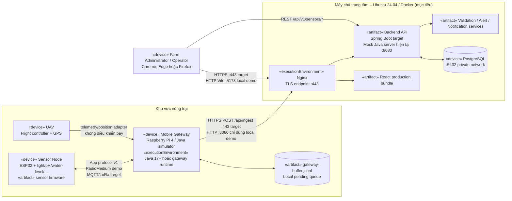
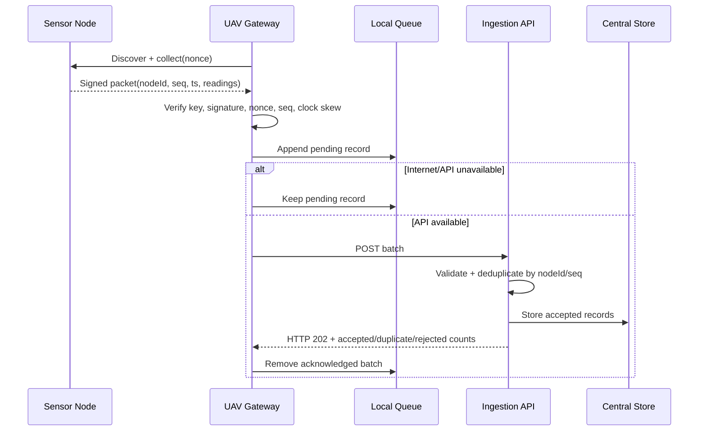

# Sơ đồ triển khai hệ thống UAV–IoT

> Mô tả vị trí triển khai, ranh giới mạng và kết nối giữa Sensor Node, UAV Gateway, Backend và Dashboard.

## 1. Mục đích và phạm vi

Tài liệu này là bằng chứng cho **SCRUM-19 / F20 – Create Deployment Diagram**. Sơ đồ phân biệt rõ hai mức:

- **Môi trường demo hiện có:** Java 17 chạy cả cảm biến, gateway và mock backend trên máy phát triển; React/Vite chạy trên Node.js.
- **Kiến trúc triển khai mục tiêu:** node ESP32 ngoài đồng, Raspberry Pi gắn trên UAV, backend và PostgreSQL trên máy chủ Ubuntu/Docker, người dùng truy cập bằng trình duyệt.

Direct UAV flight control không thuộc phạm vi phiên bản đầu. Gateway chỉ nhận vị trí/waypoint từ môi trường mô phỏng hoặc hệ thống bay tương thích và thu thập dữ liệu cảm biến.

## 2. Deployment diagram

> Mermaid dùng stereotype UML (`«device»`, `«executionEnvironment»`, `«artifact»`) để biểu diễn deployment node và artifact. `docs/Componment_design.drawio.png` là **Component Diagram**, không thay thế sơ đồ triển khai này.

## 3. Node, execution environment và artifact

| Deployment node | Execution environment | Artifact triển khai | Trách nhiệm |
|---|---|---|---|
| Sensor Node | ESP32 firmware; trong demo là JVM | Driver/simulator cảm biến, `SensorNode`, `PacketBuilder` | Đọc chỉ số, định danh node, đóng gói và ký dữ liệu |
| UAV | Flight controller/GPS bên ngoài hệ thống | Telemetry/position nếu được cung cấp | Mang gateway tới gần node; không bị web platform điều khiển trực tiếp |
| Mobile Gateway | Raspberry Pi OS + gateway runtime; trong demo là Java 17+ | `DataCollector`, `KeyStore`, `UavGateway`, `LocalStore`, `Uploader` | Discovery, authentication, collection, lưu offline và upload |
| Local Gateway Storage | Filesystem của gateway; SQLite là mục tiêu sản phẩm | Demo hiện lưu `data/gateway-buffer.jsonl` | Giữ bản ghi pending qua lúc mất kết nối |
| Central API Server | Spring Boot trong kiến trúc mục tiêu; `MockIngestionServer` trong demo | Ingestion, validation, sensor query, alert/notification modules | Nhận batch, chống trùng, lưu trữ và cung cấp API |
| Central Database | PostgreSQL trong private network | Schema sensor/device/reading/alert/mission | Nguồn dữ liệu trung tâm và audit trail |
| Web Server | Nginx + static React bundle; Vite dev server trong demo | Dashboard React | Hiển thị trạng thái, lịch sử và cảnh báo |
| User Workstation | Chrome/Edge/Firefox | Web application | Farm Administrator và UAV/Device Operator thao tác hệ thống |

## 4. Kết nối, protocol và port

| Nguồn → Đích | Protocol/port local demo | Protocol/port mục tiêu | Dữ liệu |
|---|---|---|---|
| Sensor → Gateway | Lời gọi trong `RadioMedium`, không mở port | MQTT over Wi‑Fi (`1883` trong LAN riêng hoặc `8883` TLS) hay LoRa profile đã phê duyệt | Beacon, collect request, signed sensor packet |
| Gateway → Backend | HTTP `localhost:8080`, `POST /api/ingest` | HTTPS `443` | Batch JSON, collection time/location/RSSI |
| Browser → Dashboard | HTTP `localhost:5173` | HTTPS `443` | React application |
| Dashboard → Backend | HTTP `localhost:8080/api/v1` | HTTPS `443/api/v1` | Latest sensor state và history |
| Backend → PostgreSQL | Chưa có trong mock server | TCP `5432`, chỉ private network | Central records, alerts và audit |

Port `8080` và `5173` chỉ dành cho phát triển. Không public trực tiếp các port này khi triển khai thật; dùng TLS tại reverse proxy và firewall/private network.

## 5. Luồng store-and-forward

## 6. Ràng buộc triển khai và kiểm tra

- Khóa node, mật khẩu database và API credentials phải nằm ngoài source control. Demo hiện sinh khóa node ngẫu nhiên 32 byte vào `src/farm-sim/data/node-keys.properties`; thư mục runtime này đã bị Git bỏ qua.
- Public deployment phải dùng HTTPS; database không được mở trực tiếp ra Internet.
- Backend thật phải giữ hợp đồng `POST /api/ingest` và chống trùng `(nodeId, seq)` trước khi thay mock server.
- Kiểm thử mất mạng phải chứng minh queue không mất bản ghi, upload lại sau khi kết nối phục hồi và server không tạo bản ghi trùng.
- Dashboard phải phân biệt measurement timestamp với server receipt/sync timestamp.

## 7. Traceability

| Yêu cầu | Thành phần trên sơ đồ |
|---|---|
| F18 – Discovery & Authentication | Sensor Node, Sensor–Gateway protocol, KeyStore/DataCollector |
| F19 – Collection & Validation | DataCollector, Ingestion/Validation API |
| F20 – Offline Storage & Synchronization | Local Queue, Uploader, Backend deduplication |
| F09/F10 – Detection & Notification | Alert/Notification services, Web application |
| NFR03/NFR04/NFR05 | TLS boundary, private DB, signed packet, durable queue, retry/deduplication |
