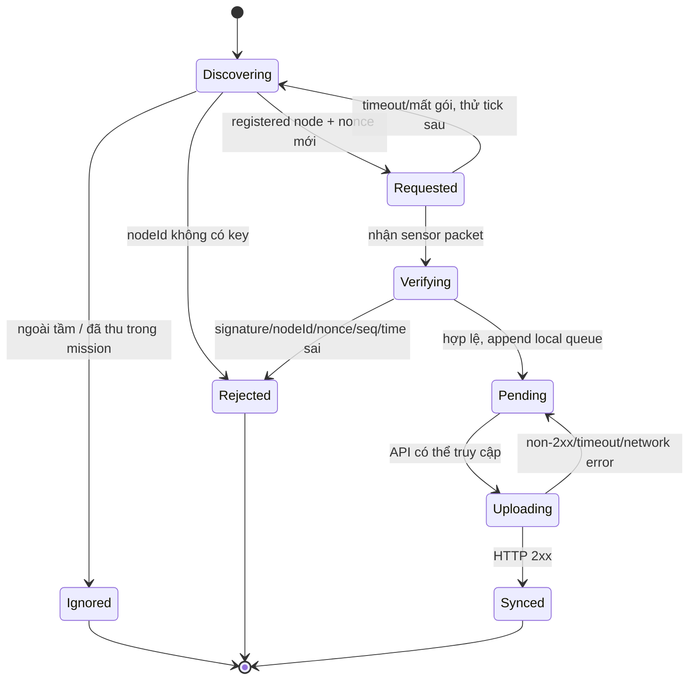

# Sensor–Gateway Application Protocol v1

> Đặc tả discovery, xác thực, đóng gói và truyền dữ liệu giữa Sensor Node với UAV Gateway.

## 1. Mục tiêu

Tài liệu này là đặc tả cho **SCRUM-29 / F23 – Design Sensor–Gateway Communication Protocol** và là hợp đồng chung giữa sensor node, UAV gateway và nhóm backend. Protocol bảo đảm:

- gateway phát hiện đúng node trong vùng phủ sóng;
- chỉ node đã provision mới được thu thập;
- packet có định danh, thứ tự, thời gian và chữ ký để phát hiện giả mạo/replay;
- mất gói hoặc mất Internet không làm mất dữ liệu;
- payload giữ nguyên khi thay simulator bằng MQTT, Wi‑Fi hoặc LoRa.

Các từ **MUST**, **SHOULD**, **MAY** lần lượt có nghĩa là bắt buộc, nên làm và tùy chọn.

## 2. Phạm vi và transport profile

Protocol v1 định nghĩa payload và state flow ở tầng ứng dụng, không khóa cứng vào một radio transport.

| Profile | Trạng thái | Cách truyền |
|---|---|---|
| Java simulator | Đã có | `RadioMedium.discover()` và `request()` gọi trực tiếp trong JVM; có range/RSSI và packet-loss simulation |
| MQTT over Wi‑Fi | Thiết kế mục tiêu | Broker cục bộ trên gateway; QoS 1 cho request/data; TLS `8883` nếu môi trường hỗ trợ |
| LoRa | Adapter tương lai | Fragmentation/ack phụ thuộc driver; payload logic vẫn giữ các field v1 |

Topic MQTT đề xuất:

```text
farm/{farmId}/sensor/+/beacon
farm/{farmId}/sensor/{nodeId}/request
farm/{farmId}/sensor/{nodeId}/data
```

Gateway subscribe wildcard beacon và data; sensor chỉ subscribe request của chính nó. Không dùng retained message cho request/data vì nonce và measurement có thời hạn.

## 3. Kiểu định danh và đơn vị

- `nodeId`: duy nhất, regex `^NODE-\d{3}$`, ví dụ `NODE-001`.
- `gatewayId`: định danh gateway, ví dụ `UAV-GW-01`.
- `seq`: số nguyên dương tăng đơn điệu theo từng node.
- `nonce`: 8 byte ngẫu nhiên, biểu diễn 16 ký tự hex trong implementation hiện tại.
- `ts`, `rxTs`, `sentAt`: ISO-8601 UTC, ví dụ `2026-11-17T09:30:00Z`.
- Các sensor key hợp lệ: `soil_moisture`, `temperature`, `humidity`, `light`, `ph`, `water_level`.
- Đơn vị hiện dùng: `%`, `C`, `lux`, `pH`. Việc dashboard đổi `C` thành `°C`, `lux` thành `Lux` hoặc water level sang cm là presentation mapping, không thay payload gốc.

## 4. Message schema

### 4.1. Discovery beacon

Sensor quảng bá beacon định kỳ hoặc trả lời discovery scan:

```json
{
  "type": "BEACON",
  "v": 1,
  "nodeId": "NODE-001",
  "model": "ESP32-SIM",
  "fw": "1.0.0",
  "farmId": "FARM-01",
  "sensors": [
    "soil-moisture-capacitive-v1.2",
    "dht22",
    "bh1750",
    "ph-probe-analog",
    "water-level-analog"
  ]
}
```

Gateway MUST kiểm tra `v`, `nodeId` và registry/key store trước khi gửi request. Beacon không chứng minh danh tính; authentication chỉ hoàn tất sau khi packet trả về có HMAC hợp lệ.

### 4.2. Collection request

Trong simulator hiện tại, gateway truyền trực tiếp `nodeId`, `nonce` và `now` vào radio adapter. Adapter mạng thật MUST biểu diễn cùng ý nghĩa bằng JSON:

```json
{
  "type": "COLLECT_REQUEST",
  "v": 1,
  "gatewayId": "UAV-GW-01",
  "nodeId": "NODE-001",
  "nonce": "9f3a1020c4b1a5e7",
  "requestedAt": "2026-11-17T09:30:00Z"
}
```

Nonce MUST mới cho từng request. Sensor MUST copy đúng nonce vào response.

### 4.3. Signed sensor packet

```json
{
  "v": 1,
  "nodeId": "NODE-001",
  "seq": 7,
  "nonce": "9f3a1020c4b1a5e7",
  "ts": "2026-11-17T09:30:01Z",
  "battery": 99.9,
  "readings": [
    {
      "sensor": "ph",
      "value": 6.42,
      "unit": "pH",
      "raw": 1878,
      "status": "OK"
    },
    {
      "sensor": "light",
      "value": null,
      "unit": "lux",
      "status": "ERROR"
    }
  ],
  "sig": "base64-hmac-sha256"
}
```

Quy tắc:

- `battery` nằm trong `0..100`.
- Reading `OK` MUST có numeric `value`; reading lỗi MUST có `value: null` và status khác `OK`.
- `raw` MAY bị bỏ nếu sensor không có ADC/raw value.
- Một packet có thể chứa nhiều sensor reading cùng measurement timestamp.

### 4.4. Gateway record và upload batch

Sau khi xác thực, gateway bọc packet bằng metadata thu thập rồi append vào local queue:

```json
{
  "gatewayId": "UAV-GW-01",
  "rxTs": "2026-11-17T09:30:02Z",
  "pos": {"lat": 10.777400, "lon": 106.702500, "alt": 30},
  "rssi": -72.5,
  "packet": {"v": 1, "nodeId": "NODE-001", "seq": 7, "nonce": "...", "ts": "...", "battery": 99.9, "readings": [], "sig": "..."}
}
```

Gateway gửi tối đa 20 record mỗi batch trong implementation hiện tại:

```json
{
  "gatewayId": "UAV-GW-01",
  "batchId": "UAV-GW-01-1",
  "sentAt": "2026-11-17T09:31:00Z",
  "records": []
}
```

Response thành công của ingestion API:

```json
{
  "batchId": "UAV-GW-01-1",
  "accepted": 6,
  "duplicates": 0,
  "rejected": [{"index": 2, "errors": ["invalid field"]}]
}
```

Backend MUST chống trùng bằng `(nodeId, seq)`. Gateway chỉ xóa batch local sau HTTP `2xx`; response `4xx`, `5xx`, timeout hoặc connection error phải giữ nguyên queue.

## 5. Tạo và kiểm tra chữ ký

Mỗi node có pre-shared key riêng được provision vào node và gateway registry. Với implementation hiện tại:

1. Tạo JSON body theo đúng thứ tự field từ `v` đến `readings`, chưa có `sig`.
2. Tính `HMAC-SHA256(key, UTF8(body))`.
3. Base64 kết quả và gắn `sig` làm field cuối.
4. Gateway tách `sig`, tái tạo chính xác body ban đầu và so sánh hằng thời gian.

Ví dụ phần được ký:

```json
{"v":1,"nodeId":"NODE-001","seq":7,"nonce":"9f3a1020c4b1a5e7","ts":"2026-11-17T09:30:01Z","battery":99.9,"readings":[]}
```

Không parse rồi serialize lại bằng thư viện có thể đổi thứ tự/format số trước khi verify. Khi thay implementation, hai phía nên chuyển sang canonical JSON được version hóa; thay đổi đó cần protocol version mới.

## 6. State flow và validation tại gateway



Gateway MUST kiểm tra theo thứ tự:

1. `nodeId` có key trong registry.
2. Packet có chữ ký đúng định dạng và HMAC hợp lệ.
3. `nodeId` trong packet trùng với beacon/target request.
4. `nonce` trùng request hiện tại.
5. `seq` lớn hơn sequence cuối đã nhận của node.
6. Chênh lệch `ts` so với gateway clock không vượt 30 giây trong profile hiện tại.

Node không đạt một trong các bước trên bị block trong mission hiện tại và lý do phải được log.

## 7. Timeout, lỗi và retry

| Tình huống | Hành vi bắt buộc | Mã/log gợi ý |
|---|---|---|
| Node ngoài tầm | Bỏ qua, không tạo alert bảo mật | `OUT_OF_RANGE` |
| Radio packet loss/timeout | Không đánh dấu done; thử lại ở tick kế tiếp khi mission còn chạy | `RADIO_TIMEOUT` |
| Unknown node | Từ chối và block trong mission | `UNKNOWN_NODE` |
| HMAC sai | Từ chối, không lưu payload | `INVALID_SIGNATURE` |
| Nonce sai hoặc seq cũ/trùng | Từ chối như replay | `REPLAY_SUSPECTED` |
| Clock skew > 30 s | Từ chối và yêu cầu kiểm tra đồng hồ | `CLOCK_SKEW` |
| Local capacity đầy | Thực thi storage policy, đếm/log dropped record | `QUEUE_CAPACITY` |
| API offline/non-2xx | Giữ nguyên pending batch | `UPLOAD_FAILED` |
| API phục hồi | Tự upload lại theo batch; server deduplicate | `UPLOAD_RETRY` |

Implementation hiện tại dùng `RetryPolicy` exponential backoff có giới hạn và jitter, reset sau lần thành công. `Uploader.syncIfDue()` được gọi định kỳ trong vòng lặp gateway, không `sleep` chặn thu thập; trạng thái `ONLINE/DEGRADED/OFFLINE` cùng lần retry kế tiếp đều quan sát được.

## 8. Security và quản lý khóa

- Demo và production MUST dùng key ngẫu nhiên tối thiểu 32 byte cho mỗi node. Demo hiện sinh/lưu key vào file runtime `data/node-keys.properties`, không hardcode và không commit.
- Không ghi key, HMAC body nhạy cảm hoặc credential vào log.
- Gateway–backend qua public network MUST dùng HTTPS và xác minh certificate.
- Rotate/revoke key phải cập nhật cả node và gateway registry; node bị revoke không được thu thập.
- HMAC xác thực payload nhưng không mã hóa nội dung. Radio profile có dữ liệu nhạy cảm SHOULD dùng link encryption/TLS phù hợp.

## 9. Compatibility và versioning

- Receiver MUST reject protocol version không hỗ trợ và log `UNSUPPORTED_VERSION`.
- Field mới tùy chọn có thể được thêm trong v1 nếu receiver bỏ qua an toàn.
- Đổi cách ký, tên field bắt buộc, đơn vị hoặc semantics cần tăng version.
- Backend mock hiện kiểm tra/trích xuất packet nhưng sensor–gateway authentication diễn ra tại gateway trước khi record được enqueue.

## 10. Test acceptance tối thiểu

1. Registered node/key đúng được discover, collect, verify và enqueue.
2. Unknown node và node ký sai bị reject, không xuất hiện trong queue.
3. Wrong nonce, duplicate/lower seq và timestamp lệch hơn 30 giây bị reject.
4. Packet loss không làm node bị đánh dấu collected; gateway thử lại.
5. Mất API giữ nguyên queue; API phục hồi upload hết pending record.
6. Gửi lại record giống nhau không tạo dữ liệu trùng ở backend.
7. Reading lỗi vẫn giữ status và không bị coi là numeric measurement hợp lệ.
