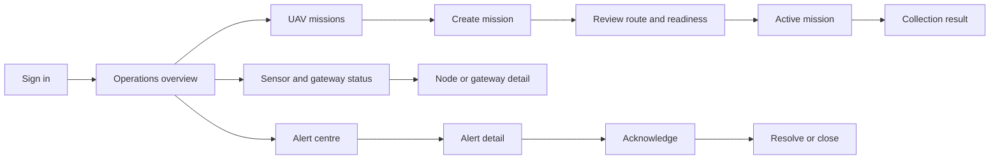
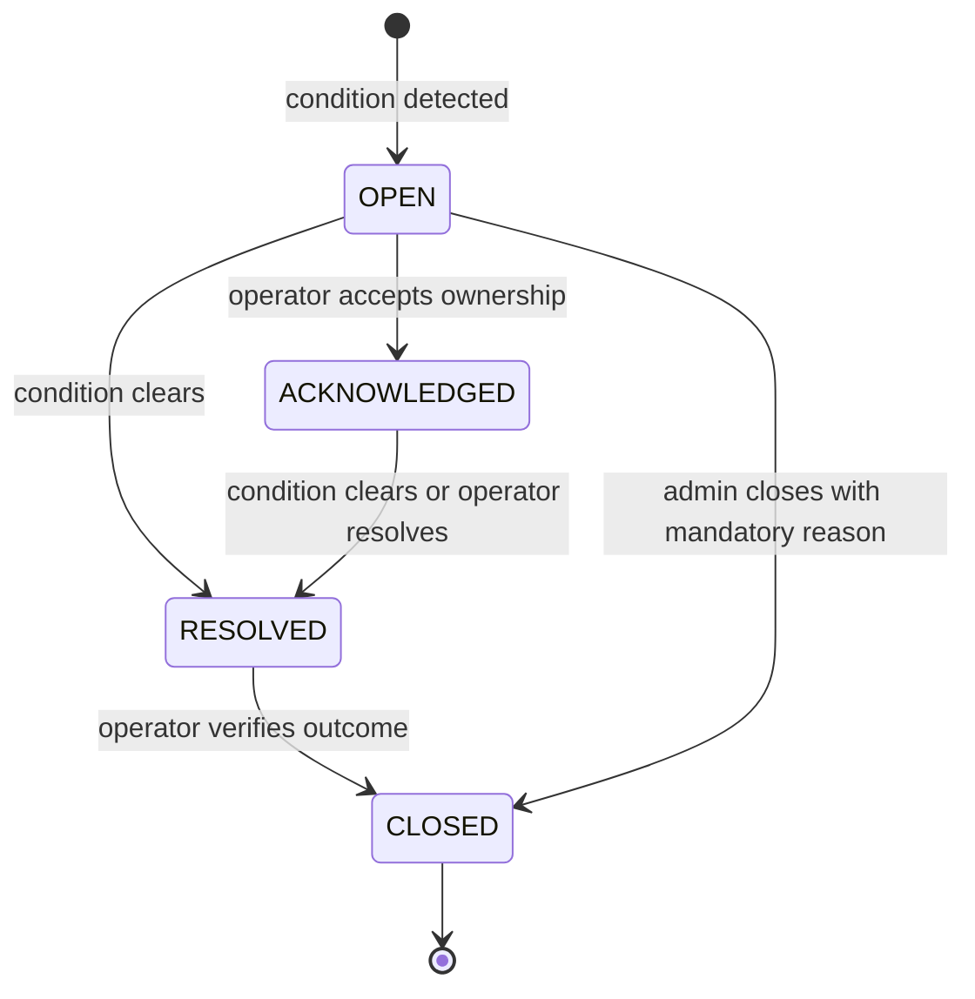

# Operator UI Wireframe and Flow

## 1. Operator goal

An operator must be able to answer four questions without opening logs:

1. Is the sensor–gateway system ready for a collection mission?
2. Which nodes and waypoints will the mission visit?
3. Is an active mission collecting and synchronizing data successfully?
4. Which alert needs action, who acknowledged it, and when was it closed?

## 2. Information architecture



Global navigation is persistent on desktop and collapses into a drawer on mobile:

```text
┌──────────────────────────────────────────────────────────────────────────────┐
│ UAV–IoT Farm   Overview  Missions  Devices  Alerts(3)     LQ / Operator  ▾ │
└──────────────────────────────────────────────────────────────────────────────┘
```

## 3. Screen A – Operations overview

Purpose: show readiness and exceptions first. This extends the existing sensor dashboard without hiding the live/mock data source.

```text
┌──────────────────────────────────────────────────────────────────────────────┐
│ Operations overview                  Data: ● LIVE     Last refresh 10:42  ↻ │
├────────────────┬────────────────┬────────────────┬───────────────────────────┤
│ Nodes          │ Gateway        │ Pending queue  │ Open alerts               │
│ 6/6 reachable  │ GW-UAV-01      │ 12 records     │ 3 (1 critical)            │
│                │ ONLINE · 78%   │ retry 00:24    │ [Review alerts]           │
├───────────────────────────────────────────┬──────────────────────────────────┤
│ Farm map / latest collection              │ Next mission                    │
│  ● NODE-001 normal                        │ M-024 · 11:00                   │
│  ● NODE-002 warning                       │ 6 nodes · 4 waypoints           │
│  ○ NODE-006 no data                       │ [Readiness check] [Open]        │
├───────────────────────────────────────────┴──────────────────────────────────┤
│ Recent activity: collected → queued → retrying → synchronized               │
└──────────────────────────────────────────────────────────────────────────────┘
```

Required states:

- `LIVE`, `DEGRADED`, `OFFLINE` and `DEMO DATA` are always visible;
- queue count and next retry time remain visible while offline;
- critical alert uses text + icon as well as colour;
- empty, loading, API error and permission-denied states have an explicit message and recovery action.

## 4. Screen B – Mission planner

Purpose: select nodes, order waypoints and verify readiness before starting a UAV collection mission.

```text
┌──────────────────────────────────────────────────────────────────────────────┐
│ Create mission                                      Draft saved 10:45       │
├───────────────────────────────┬──────────────────────────────────────────────┤
│ Mission details               │ Route preview                                │
│ Name      [Morning North____] │       2 ●────────● 3                         │
│ Gateway   [GW-UAV-01       ▾] │        ╱          ╲                          │
│ Farm      [Farm A          ▾] │     1 ●            ● 4                       │
│ Nodes     [✓001 ✓002 ✓003]    │                                              │
│ Altitude  [30] m              │ Drag waypoint · distance 1.8 km              │
│ Speed     [5] m/s             │                                              │
├───────────────────────────────┴──────────────────────────────────────────────┤
│ Readiness: ✓ gateway online  ✓ keys provisioned  ! NODE-006 has no data     │
│                                      [Save draft] [Review mission →]         │
└──────────────────────────────────────────────────────────────────────────────┘
```

Validation blocks review/start when:

- no gateway, node or waypoint is selected;
- gateway is offline or battery is below the configured safe level;
- a selected node has no provisioned identity/key;
- the route contains an invalid coordinate or duplicate waypoint.

The operator may override a warning only by entering a reason. Errors cannot be overridden.

## 5. Screen C – Active mission

Purpose: monitor a mission without implying that this application directly controls UAV flight.

```text
┌──────────────────────────────────────────────────────────────────────────────┐
│ M-024 · ACTIVE      4/6 nodes collected       Gateway link: DEGRADED        │
├───────────────────────────────────────────┬──────────────────────────────────┤
│ Route and UAV-reported position           │ Collection timeline              │
│  ✓ WP1 → ✓ WP2 → ● WP3 → ○ WP4           │ 10:51 NODE-001 verified          │
│                                           │ 10:52 NODE-002 stored locally    │
│ Position last updated 8 s ago             │ 10:53 Upload failed · retry 24 s │
├───────────────────────────────────────────┴──────────────────────────────────┤
│ Local queue 12 · uploaded 18 · rejected 1 · dead-letter 0                  │
│ [Open gateway diagnostics]                    [Abort mission…]               │
└──────────────────────────────────────────────────────────────────────────────┘
```

`Abort mission` is a recorded workflow action, not direct flight control. It requires confirmation and an operational note. Loss of telemetry shows `POSITION STALE`; it must not display a moving UAV from old data.

## 6. Screen D – Devices

Purpose: inspect sensor and gateway health, identity and last collection evidence.

```text
┌──────────────────────────────────────────────────────────────────────────────┐
│ Devices  [Search ID…] [All types ▾] [Needs action ▾]                       │
├──────────┬─────────┬──────────┬─────────┬──────────────┬────────────────────┤
│ ID       │ Type    │ Status   │ Battery │ Last seen    │ Action             │
│ NODE-001 │ Sensor  │ NORMAL   │ 83%     │ 2 min ago    │ View               │
│ NODE-002 │ Sensor  │ WARNING  │ 18%     │ 3 min ago    │ View alerts        │
│ NODE-006 │ Sensor  │ NO DATA  │ --      │ Never        │ Check provisioning │
│ GW-01    │ Gateway │ OFFLINE  │ 62%     │ 12 min ago   │ Diagnostics        │
└──────────┴─────────┴──────────┴─────────┴──────────────┴────────────────────┘
```

Device detail shows identity, firmware, farm/zone, last measurement time, last synchronization time, signal, queue count and recent authentication failures. Secrets and HMAC keys are never rendered.

## 7. Screen E – Alert centre and lifecycle

Purpose: prevent an alert from disappearing without an auditable operator action.

```text
┌──────────────────────────────────────────────────────────────────────────────┐
│ Alerts  [OPEN 3] [ACKNOWLEDGED 2] [RESOLVED] [CLOSED]                      │
├──────────┬──────────┬──────────┬──────────┬───────────────┬─────────────────┤
│ Severity │ Type     │ Device   │ Age      │ Owner         │ Action          │
│ CRITICAL │ TIMEOUT  │ NODE-006 │ 49 h     │ Unassigned    │ Review          │
│ WARNING  │ BATTERY  │ NODE-002 │ 18 min   │ LQ            │ Open            │
└──────────┴──────────┴──────────┴──────────┴───────────────┴─────────────────┘

Alert ALT-123 · DATA_TIMEOUT · NODE-006
Evidence: last packet 08:14 21/11 · threshold 48 h · current 49 h
History: created → acknowledged by LQ → resolved automatically → closed by LQ
Note [________________________________________________________]
[Acknowledge] [Resolve] [Close]
```

State transitions:



Every transition records actor, timestamp and note. A condition recurring after resolution/closure creates a new alert ID rather than reopening the old audit record. Destructive or exceptional actions require confirmation.

## 8. Roles and permissions

| Action | Viewer | Operator | Administrator |
|---|:---:|:---:|:---:|
| View sensor, mission and alert data | ✓ | ✓ | ✓ |
| Create/edit mission draft | – | ✓ | ✓ |
| Start/abort mission workflow | – | ✓ | ✓ |
| Acknowledge/resolve alerts | – | ✓ | ✓ |
| Change thresholds or provision devices | – | – | ✓ |
| Manage users and roles | – | – | ✓ |

If an API returns `401`, the UI asks the user to sign in again. For `403`, it keeps the data visible when allowed but disables the action and explains the missing permission.

## 9. Responsive and accessibility rules

- Desktop ≥ 1024 px: map/table and details may use two columns.
- Tablet 768–1023 px: details open in a side sheet.
- Mobile < 768 px: single column; primary action remains visible at the bottom.
- Keyboard focus follows navigation order and is always visible.
- Status never relies on colour alone; use icon, label and timestamp.
- Form errors appear beside the field and in a summary at the top.
- Minimum touch target is 44 × 44 px; text contrast targets WCAG AA.

## 10. API handoff map

| Screen | Required capability | Current demo evidence | Backend contract still required |
|---|---|---|---|
| Overview / Devices | Latest readings and history | `/api/v1/sensors/latest`, `/sensors/{id}/history` | Pagination and role enforcement |
| Alerts | List/detail/status transition | `/api/v1/alerts`, `/alerts/{id}` | Authenticated actor/role |
| Thresholds | Read/update alert rules | `/api/v1/config/alert-rules` | Production RBAC/audit integration |
| Missions | Draft, route, start, status, result | Simulator mission logs only | Mission CRUD and telemetry APIs |
| Gateway diagnostics | Connectivity, queue and retry | Runtime summary/logs | Read-only diagnostics endpoint |

## 11. Artifact checklist and review gates

- [x] Navigation and operator role are defined.
- [x] Overview, mission, device and alert screens have wireframes.
- [x] Loading, offline, error and permission states are specified.
- [x] Mission readiness and alert lifecycle are documented.
- [x] Responsive and accessibility behaviour is documented.
- [x] Current demo capability is separated from future backend API work.

External review gates (not missing wireframe content):

- [ ] Product owner confirms wording and priorities.
- [ ] Frontend/backend owners approve the API handoff map before implementation.

